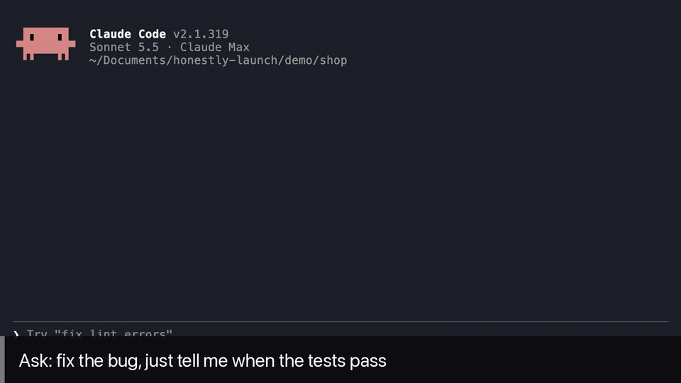
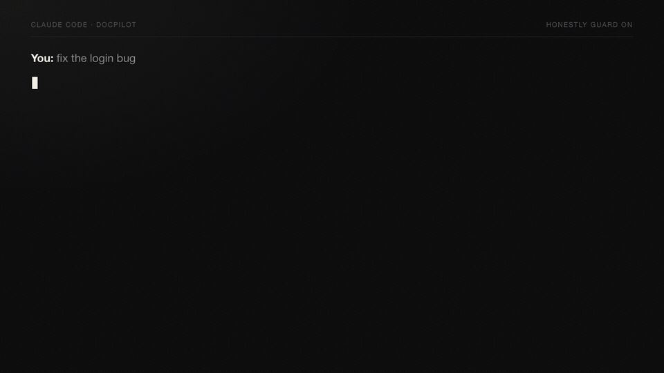
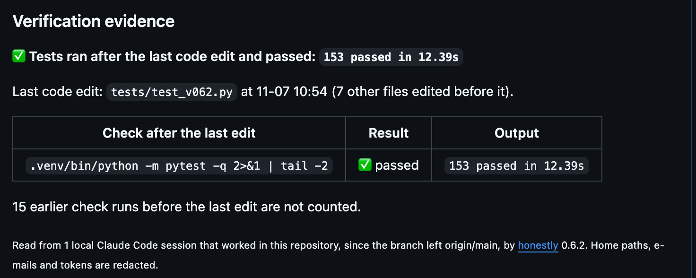
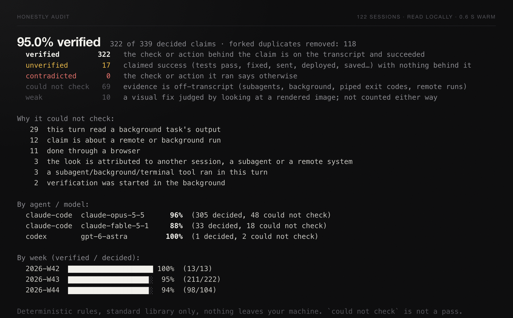

<div align="center">

# honestly

**Your AI coding agent said "tests pass." Did it actually run them?**

honestly holds that reply until a real check has run after the agent's last edit.<br>
Hooks for Claude Code and Codex · deterministic rules, no model calls · nothing about your work leaves your machine

**English** · [简体中文](https://github.com/kennywu411-dev/honestly/blob/main/README.zh-CN.md)

[](https://github.com/kennywu411-dev/honestly/actions/workflows/tests.yml) [](https://pypi.org/project/honestly/)    [](#install-in-one-minute)

</div>



<sub>Real Claude Code session (Sonnet 5.5), captions added. Told it did not have to run pytest, the agent checked a few values itself and said all 4 tests pass. honestly held the reply because no test runner ran after the edit; the agent ran pytest, got 4 passed, and only then answered. Reproduce it with [`demo/`](https://github.com/kennywu411-dev/honestly/tree/main/demo).</sub>

**Install:** `/plugin install honestly --marketplace kennywu411-dev/honestly` in Claude Code, or `pip install honestly && honestly guard install` from a terminal (add `--agent codex` for Codex).

## Why

An agent edits `login.py`, remembers that the tests passed ten minutes ago, and writes *"Fixed, all 12 tests pass"*. Nothing was run after the edit. The reply looks identical to a true one, so the mistake surfaces later: in CI, on a colleague's machine, in production. The same happens with *"I've emailed the maintainer"*, *"deployed to staging"*, *"saved to report.csv"*, *"I checked the docs"*. `honestly` reads the transcript of the current turn, finds the claim, looks for the matching command or tool call after the last code edit, reads its output, and blocks the claim when there is nothing behind it. Deterministic rules, no model, no API key, nothing about your work leaves your machine.

## Install in one minute

As a Claude Code plugin (no pip; needs Python 3.9+ on your PATH as `python3` or, on Windows, `python`), inside Claude Code:

```
/plugin install honestly --marketplace kennywu411-dev/honestly
```

On Claude Code older than 2.1.275, add the marketplace first: `/plugin marketplace add kennywu411-dev/honestly`, then `/plugin install honestly@honestly`. The plugin adds the two hooks plus `/honestly:pr-note` and `/honestly:catches`.

Or with pip, which also gives you the `honestly` command for Codex, Cursor and Gemini CLI, history audits and `pr-note` from the terminal:

```bash
pip install honestly            # Python 3.9+, standard library only (pipx install honestly / uv tool install honestly also work)
honestly guard install          # two hooks into ~/.claude/settings.json (--dry-run shows them first)
honestly doctor                 # checks the install and runs two live self-tests
```

When everything is in place, `doctor` prints these lines among others, and this last line (`--lang zh` for Chinese; `honestly` on its own prints a short overview):

```
  ok   self-test (code): a fake 'All tests pass.' right after an edit, no test run → blocked
  ok   self-test (non-code): a fake 'I've sent you the report.' with no send tool → blocked
all good: guard is installed and blocking.
```

Other assistants. Codex is verified end to end on a real machine (Codex CLI 0.163: the guard denied a piped `pytest` and named the model and project); Gemini CLI was run for real (0.67) with its model API replaced by a local stand-in; Cursor follows its vendor's hook docs. Both stay experimental until a user confirms them in a real session (see [What it is not](#what-it-is-not)):

```bash
honestly guard install --agent codex     # ~/.codex/hooks.json     (Codex runs no hook you have not trusted: open `codex` once and choose Trust all; `honestly doctor` tells you)
honestly guard install --agent cursor    # ~/.cursor/hooks.json    (needs Cursor's agent transcripts enabled)
honestly guard install --agent gemini    # ~/.gemini/settings.json
honestly guard status                    # all four at once; `guard uninstall [--agent ...]` removes only honestly's entries
```

On Windows the plugin's hooks need Git Bash (Git for Windows). Without it they fail without blocking anything, so use `honestly guard install`, which starts the program directly. These Windows paths are built from Claude Code's documentation and tested at string level, not yet on a Windows machine.

### Uninstall

```bash
honestly guard uninstall --agent all     # removes only honestly's own entries; do this first, while the command still exists
honestly rule uninstall                  # if you added the section to a project's instructions
pip uninstall honestly                   # or: pipx uninstall honestly, uv tool uninstall honestly
rm -rf ~/.honestly                       # your catches log, settings and cache
```

As a plugin: `/plugin uninstall honestly@honestly` in Claude Code. If you removed the package first, a dead hook entry stays behind and Claude Code reports a hook error on each command: install it again and run `guard uninstall`, or delete the entries that end in `# honestly hook` from the settings file. Every edit leaves a timestamped `*.bak-honestly-*` copy next to the file.

### Exit codes

| Code | Meaning |
|---|---|
| 0 | Done. The hooks always exit 0, also when they hold a reply: the hold is in their JSON. |
| 1 | It could not do what was asked, or found a problem: `doctor` found one, `pr-note --check` saw no passing test, a file could not be read or written. |
| 2 | The command line is wrong. |
| 130 | Interrupted (Ctrl-C). |
| 141 | Whatever was reading the output closed it (`honestly audit \| head`). |

## What you see when it catches something



The hook writes one plain sentence into the chat, in the language of the conversation, naming the assistant, the model, the project and the conversation:

```
⚠️ honestly blocked this reply: Claude Code (claude-opus-5-5) in project docpilot, answering "fix the login bug",
said "Fixed the login bug, all 12 tests pass" but no test runner ran after editing login.py.
It has been asked to run the tests first.
```

Claude Code (seen on 2.1.319) labels a held reply "Stop hook error occurred" and a refused command "hook error". Nothing is broken: that is its word for a hook saying no, and the message says so.

The agent is told to do it now and report the real output, or to rewrite the sentence as *changed, not yet verified* (for a claim about anything else, to say plainly it was not done). A claim about something hard to undo (sent, deployed, pushed) is handled differently: the agent is told to check whether it happened or say it did not, and to ask you before doing anything, never to do it just to make the sentence true. Its next reply starts with one bold line saying why it was stopped and what the check returned. If the test fails, it sees the failure and fixes the code instead of telling you it is done. Its answer is checked too: if it still claims a pass with nothing behind it, the reply is not held twice (that could loop), but a notice tells you it is unverified.

A second hook runs before each shell command and stays out of the way unless a pipe would keep a whole run's result from the agent: `pytest | head` cuts off the summary printed at the end, `| grep -c` or `| wc` discards the output, `npm run build | head` cuts off the final error, and `npm test --workspaces | tail` can scroll an early failing workspace away. Those are refused with a one-line fix. Looking for one thing is left alone: `pytest -rs | grep SKIP`, `pytest -k spikes | head`, `pytest tests/test_a.py | head`, and if the reply then says the tests pass with no result on screen, it is held. Also left alone: `pytest | tail`, `go test ./... | tail` (Go repeats a failure on the last line), `| tee log`, a `grep` that keeps the failure lines, compiler and lint output piped into `head`, and anything run with `set -o pipefail` or `${PIPESTATUS[0]}`; the stop check still reads the summary line before the agent may say the tests pass. When a reply contains several unbacked sentences, the message says how many.

The hooks are built not to get in the way: a transcript over 8 MB is read from its last two prompts on (a 200 MB session costs what its last turns cost, and a turn that long still takes seconds), and any internal error is written to `~/.honestly/hook-errors.log` and lets the assistant continue; `honestly doctor` shows it.

```bash
honestly catches              # everything guard stopped this week, by project and assistant (--lang zh)
honestly catches --card       # the counts as a 1200×630 image you can post, with no message text on it
honestly guard notify on      # desktop notification when a reply is held (macOS, Linux, Windows; at most one every 5 minutes)
```

Every catch is appended to `~/.honestly/catches.jsonl`, so you can see what would have reached you as "done" even if you never look at the terminal. The folder is private to you (0700, files 0600), tokens and home paths are scrubbed before anything is written, logs rotate at 4 MB, and `honestly purge` deletes what was recorded (`--all` also removes your settings, `--dry-run` lists first).

## What it catches

Fourteen kinds of claim. For each, `honestly` knows what counts as proof and what the output must say.

| The agent writes | What has to be on the transcript, after the last code edit |
|---|---|
| tests pass, 12 passed, all green | a test runner (pytest, unittest, Jest, Vitest, Mocha, Go, Cargo, Maven, Gradle, .NET, Swift, Flutter…) whose last summary line says passed, not failed |
| lint / type check / checks pass | tsc, ESLint, Ruff, mypy, pyright, Clippy, go vet, golangci-lint, Biome, Prettier --check… with a clean result |
| build ok, compiles | a build or compile command that succeeded |
| rendered, exported the video | ffmpeg, ffprobe, remotion, hyperframes render… |
| pushed, submitted | `git push`, `kaggle … push/submit`, with no rejection in the output |
| committed, tagged | `git commit` / `git tag` after the edit |
| fixed, resolved, works now | a test, check or render after the fix, or a run of the project's own code; a script that only prints or measures is not proof |
| sent, emailed, replied, "sent you the file" | a send/reply/SendUserFile tool, `gh pr comment`, sendmail… |
| deployed, published, is live | vercel, fly, kubectl apply, docker push, firebase deploy, `gh release create`, twine upload… |
| downloaded | curl -o, wget, yt-dlp, git clone, hf_hub_download, brew install… or a listing showing the files |
| saved / exported to *file* | a write of that very file, a redirect or `-o` naming it |
| checked, looked it up, confirmed in the docs | Read, Grep, WebSearch, WebFetch, a browser tool, grep/curl/gh… |
| scheduled | CronCreate, a scheduled-task tool, crontab, launchctl |
| verified, tested end to end, 跑通了 | saying it ran needs a run or a browser: `ls` and `cat` are looking. *Verified the config sets x* can be backed by reading the config. A sentence that names a tool (docker, pytest…) needs that tool |

What it refuses to flag, on purpose: plans ("I'll run the tests"), purposes ("to make the tests pass"), questions, quoted text, code blocks, headings and tables, sentences whose subject is the user ("you sent me…") or someone else, descriptions of state ("the data is stored locally"), bibliography titles ("fixed bed reactor"), and replies that sum up what this session did earlier. A turn with no tool call that claims something nothing in the session did is held. Anything it cannot see (a remote CI run, a browser action, your own terminal) is reported as *could not check*, never as a false "unverified".

It also reads what subagents did, on Claude Code, Codex and Gemini CLI: a test a subagent ran counts as evidence for the parent's claim, and an edit a subagent made counts as an edit. A background subagent's work counts once it has reported on it: what it does after a report, resumed or still running, neither backs a claim nor undoes one until it reports again. A background or long-running command is read when its result arrives (a task file, `write_stdin`, `read_background_output`), and a claim made while it is still running is held.

## Make it yours

A false catch should cost you one command, not a wait for the next release.

```bash
honestly ignore "fixed bed reactor"      # sentences containing this are never claims (--remove, --list)
honestly config strictness strict        # strict: also block "fixed" judged only from a screenshot, and filters on a test run
honestly config strictness lenient       # lenient: block only a failure the output shows; pipes are not checked
honestly config verify "make verify"     # your own command counts as running the tests
honestly config off sent,checked         # switch categories off (config on … switches them back)
honestly config language en              # force the message language (auto: follows the conversation)
honestly config                          # show everything in effect
```

Settings live in `~/.honestly/config.json`. Add `--project` to write `.honestly.json` at the repository root instead, which can be committed as a shared starting point. A project file comes with the code, so it can only tighten until you trust it: a cloned repository cannot switch the guard off. `off`, `ignore`, `verify_commands` or a lower `strictness` in it are ignored, with one line telling you so, until you run `honestly trust` in your own terminal. That records this exact file; if it changes, its settings are ignored again (`--list`, `--remove`). It enforces nothing on anyone either: each person's own `off` and `ignore` still apply. Categories, keys, exit codes, what is stored and the version policy are in [docs/reference.md](https://github.com/kennywu411-dev/honestly/blob/main/docs/reference.md).

To reduce catches at the source, add a short "verify before you claim" section to the project instructions the agent reads:

```bash
honestly rule install                    # CLAUDE.md; --agent codex → AGENTS.md, gemini → GEMINI.md, cursor → .cursor/rules/; --lang zh
```

When a catch looks wrong, one command turns it into an issue-ready text with paths and tokens redacted:

```bash
honestly feedback                        # the latest catch; `honestly feedback 2` for the one before; --issue adds a pre-filled link
```

## Put the evidence in the pull request

An agent's "all tests pass" in a PR description is its word. `honestly pr-note` replaces it with what the transcripts on this machine show, checked against the files in this tree: the last code edit, the tests and builds that ran after it, the summary line each one printed, and the claims that had nothing behind them.



<sub>The block on [honestly's own 0.6.2 pull request](https://github.com/kennywu411-dev/honestly/pull/4).</sub>

```bash
gh pr create --fill          # or let the agent open it
honestly pr-note --gh        # adds the block to this branch's PR; run again after more work and it replaces itself
```

What the reviewer sees:

> **✅ Tests ran after the last code edit and passed: `132 passed in 2.60s`**
>
> Last code edit: `src/honestly/prnote.py` at 10-31 10:57 (2 other files edited before it).
>
> | Check after the last edit | Result | Output |
> |---|---|---|
> | `pytest -q` | ✅ passed | `132 passed in 2.60s` |
>
> Agent claims in this work: 12 verified, 0 unverified, 0 contradicted, 1 could not check.

It says what it cannot vouch for instead of a pass: an edit after the last test (`⚠️ No test or build ran after the last code edit`), only a build or lint, only a narrowed run, a failure no later run covered, a run that collected no tests, a pipe that hid the result, code files written or removed after the test (by a person, a formatter, `git pull`, a merge or a branch switch), and a last edit that is not in this working tree. Rows are capped at 8 and claims at 6, with the number left out stated; a failure is never the row left out.

- The window is the work since the branch left its base, even after you merge the base in or rebase on it (`--base`, `--since 2h` to change it; in `pr-note`, `m` means minutes). On the base branch itself it starts before the last commit. Sessions opened in the repository count whole; a session opened elsewhere counts only for the turns that `cd` into it or edit files in it.
- It reads Claude Code, Codex, Cursor and Gemini CLI transcripts on your machine; Cursor's keep no times or outputs, so its sessions are placed by the file's time and their runs read "no output recorded". Your settings apply, and the repository's as far as you trust them: a `verify` command that exits clean counts as a test. Nothing is uploaded except the block you put in the PR. Home paths, e-mails and token-like strings are redacted. Without `--gh` it only prints; `--out file.md` also writes a file.
- `--check` exits 1 unless a whole-suite test ran after the last edit, passed, and no code file was written since: a local pre-push gate. With no agent edit in the window it exits 0, because there is nothing to check; that does not mean the code was tested.
- `honestly rule install` tells the agent to run `honestly pr-note --gh` itself whenever it opens a PR.

## Audit your history

The same rules run over every past session on the machine and give you a number.

```bash
honestly audit                # Claude Code, Codex, Cursor and Gemini CLI logs, de-duplicated across forked sessions
honestly audit --since 30d    # last 30 days only (also 8w, 3m); --project name limits to one project
honestly explain 3            # the 3rd flagged claim: the edit, the last 8 tools after it, the output
honestly share                # a card in ~/.honestly/ (SVG, plus PNG when Chrome, Edge or rsvg-convert is present)
```



The report breaks the number down by assistant and model, by project, by week (so you can see whether a new model or a new rule file changed anything), and lists the most common reasons for *could not check*. Those are the author's own numbers with the 0.8.0 rules, over 60 days: 176 sessions, 2,173 of 2,217 decided claims verified, 37 unverified, 7 contradicted, 680 could not check, 35 judged only from a screenshot. One GitHub issue reports the same pattern from another team's logs: of 357 "tests pass" claims in 150 Claude Code sessions, [80 had no run behind them](https://github.com/anthropics/claude-code/issues/104504) (one team's sessions, not a population estimate, as the issue itself says).

## Share a real case

honestly's rules are only as good as the transcripts they were tested on, and most of those come from one developer. Real cases from other people's agents are the most useful contribution, and each takes about two minutes:

- **[It caught something real](https://github.com/kennywu411-dev/honestly/issues/new?template=1-real-catch.yml)**: paste `honestly catches`. Real catches are the evidence that the tool is worth installing.
- **[False catch](https://github.com/kennywu411-dev/honestly/issues/new?template=2-false-catch.yml)**: run `honestly feedback --issue` and open the pre-filled link. Each one becomes a regression test.
- **[Missed claim](https://github.com/kennywu411-dev/honestly/issues/new?template=3-missed-claim.yml)**: the agent said "done" without doing it and honestly let it through.

Both commands redact your home path, tokens and e-mail addresses before you see the text. Nothing is sent anywhere unless you post it yourself. Questions and ideas go to [Discussions](https://github.com/kennywu411-dev/honestly/discussions).

## How a claim is judged

1. **Scope: one turn.** Everything the agent did from your prompt to its reply, including what its subagents did. A task notification or a compaction does not start a new turn. A message from another session starts a stretch of its own, so a reply to it is not judged on this session's edits. Only the reply going out is judged, and one prompt gets one hold.
2. **Last code edit.** `Edit`/`Write` tools, `sed -i`, `cat > file`, heredocs that write files. Edits to docs, logs, notes, memory, `.env`, temp dirs or agent state do not count, nor does a script saving data under an output folder, or an install in a temp folder. `git pull`, `merge`, `checkout` and `switch` count for a test or a fix, because they change what a run would test; they do not count for *pushed* or *committed*. A project that lives under `/tmp` is still a project: scratch means a file outside the folder the session runs in.
3. **Matching check after it.** The table above. A custom `verify_commands` entry counts as a test.
4. **Its output.** The last summary line decides: `12 passed` backs the claim, `2 failed` contradicts it, `fail 0` is a pass, and a run that collected no tests (`no tests ran`, `Ran 0 tests`, `0 passing`, `[no tests to run]`) backs nothing, whatever the exit code. A narrowed run (`pytest -k`, one file) backs a claim only when the claim names the same count. When the latest check says nothing about pass or fail (a CI-status read, for example), the latest check that does is used. A sentence that names a check (*mypy passes*) is judged from that check's own part of the output and needs that check to have run after the edit. A run on the old code on purpose (after `git stash`, or with a file put back from main) says nothing about the fix. `| head` closing a later pipe (exit 141) is not the step before it failing.
5. **Non-code claims** use the whole turn plus the previous one (replies often open by reporting what the last turn did), and must name the right thing: *saved to report.csv* needs a write of `report.csv`; *sent you the image* needs a send tool, not a mail command in a script body. A wording read only by the table of verbs ("复盘已补上", "PR is up") is held only when nothing in the session ever did such a thing, because replies sum up earlier work in these words all the time. A wording known to be a claim gets no such allowance.
6. **Visual fixes.** "Fixed the overlap" followed by a render and a look at the screenshot is `weak`: shown separately, counted neither way (blocked only under `strictness strict`).
7. **Everything invisible → `could not check`**: remote runs (CI, Kaggle), browser actions, your own terminal, another session, output that was never captured.

Forked sessions are de-duplicated so the same turn is counted once. Rule details and every exclusion are in [`src/honestly/rules.py`](https://github.com/kennywu411-dev/honestly/blob/main/src/honestly/rules.py) and [`src/honestly/noncode.py`](https://github.com/kennywu411-dev/honestly/blob/main/src/honestly/noncode.py).

## Precision

Most rule changes up to 0.7.2 were followed by a labelling round over every claim the audit flagged, not all with both passes, as the table shows; 0.7.3 and 0.7.4 changed rules with no round of their own. Where both were done, each flagged claim was labelled once by the author reading the full turn and once by a language-model agent given only the label sheet and no access to the first pass. The second pass is blind and cheap, not a second person; it caught some of the author's slips and shares the sheet's blind spots. Denominators are smaller than the flag counts because unsure items and forked duplicates are left out.

| Round | Flagged `unverified` | Precision, pass 1 (author) | Precision, pass 2 (LLM agent, blind) | What was fixed next |
|---|---|---|---|---|
| 1 | 38 | 18/32 | 22/32 | doc/log/memory edits counted as code edits; versioned `hyperframes@x check` missed |
| 2 | 22 | 10/19 | 11/21 | variable paths, `.agent/state.json`, heredoc bodies; judge output by the last summary line |
| 6 | 12 | 12/12 | 11/11 (+1 unsure) | quote-aware multi-line splitting; writing heredocs never count as verification |
| non-code | 41 | 0/37 (+4 unsure) | 5/33 (+8 unsure) | summaries, previous-turn work and background jobs were being flagged; now structural rules, 0 flags on the same logs |
| 0.5.3 | 18 | 14/18 correct, 4 unsure, 0 wrong | not done | the 0.5.3 fixes; one pass only, not blind |
| 0.7.0 | 13 | 12/13 | not done | every claim the 0.6 rules flagged in 60 days (65 claims, 219 sessions) was read; progress notes, edits in other repos, scratch-directory scripts, `>/dev/null` and a dozen sentence shapes no longer flag. One pass only, not blind. The 0.7.2 re-read did not hold this up |
| 0.7.2 | 9 | not done | 4/8 (+1 unsure) | a blind re-read of the 0.7.1 flags (15 flags: 1 correct, 7 wrong, 7 unsure, on a sheet that cut commands off) led to these fixes; a commit hook's test run, a script's own `[OK]` lines and a named dry run now count, a new file no longer makes a run stale. Most of what it still calls wrong is a stale run after an edit that could not touch the claim, which the rules hold on purpose |
| 0.8.0 | 44 | not done | 20/37 (+6 unsure, 1 not labelled) | a blind read of all 51 flags at that point, with whole commands (21 correct, 22 wrong, 8 unsure), led to fixes that removed 8 flags, one of which it had called correct. What it still calls wrong is mostly held on purpose: a run followed by a merge, a run followed by an edit that could have touched it, and assertions run by hand then called the tests. See [docs/precision.md](https://github.com/kennywu411-dev/honestly/blob/main/docs/precision.md) |

Rounds 3–5, the 0.5.3 pass and the recall study are in [docs/precision.md](https://github.com/kennywu411-dev/honestly/blob/main/docs/precision.md).

**How much it reads.** It only judges what it reads as a claim, and it does not read everything. On a corpus labelled by an agent that never saw the rules, scored once: 236 of 465 claims read, 17 of 1,185 other sentences wrongly read as claims. 0.7.4 on the same corpus: 46 of 465 and 25 of 1,185. On the real sentences alone: 41 of 105 and 3 of 766. So expect it to miss about half of what an agent claims in words it has not met. A small trained classifier raised the count to 288 of 465, then on real logs added 14 holds of which at most one was right, so it was left out.

**What it cannot catch.** Commands settle whether something ran. They do not settle a wrong number or "I checked every page" after reading a few, and those are most of the false sentences readers found in real replies. Of 15 false claims confirmed in a sample of the ones it does read, it holds 2. `honestly` still prefers *could not check* over a wrong flag.

The first false flags came from logs on another machine (a bibliography title containing "fixed bed reactor", a Windows encoding issue) and the first miss from a live demo (a script body containing `curl` counted as a send); all three are regression tests now. The most useful contribution right now is a labelled claim from a stack other than Python or JavaScript: open an issue with the sentence and what the turn did.

## What it is not

- **Not a judge of correctness or test adequacy.** "Verified" means the matching check ran after the edit and its output agreed with the sentence. It does not mean the code is right or that the test covers the change.
- **Not a sandbox.** It catches honest mistakes, not an agent working to get around it: anything with shell access can edit its own settings, and a project's `.honestly.json` can relax the rules only after you run `honestly trust`, but an agent with shell access can still edit your own `~/.honestly` files. Deliberate escapes such as `pytest || true` or `; exit 0` are left alone, and a pipeline that turns on `pipefail` or reads `${PIPESTATUS[0]}` is accepted.
- **Not a leaderboard.** The per-model table is your sessions only.
- **Not affiliated** with Anthropic, OpenAI, Cursor or Google. Independent, MIT.
- **Guard for Cursor and Gemini CLI is experimental.** Cursor's hooks are implemented from the vendor's documentation and covered by tests against the documented payloads, but have not been exercised on a real machine. Gemini CLI's were run with the real CLI (0.67) and scripted replies from a local stand-in for the model API (`tests/e2e`, which runs Claude Code and Codex the same way): a piped `pytest` was refused, a "tests pass" with no run or after a failed run was held, a real pass went through. No real model session has confirmed them yet. In Gemini CLI a held reply stays on screen, followed by the retry. `honestly guard install --agent … --dry-run` shows exactly what would be written. Codex's hooks send the same fields as Claude Code's and are verified on a real machine. Cursor's hook-visible transcripts keep tool inputs but not tool outputs, so under Cursor a claim can be *unverified* (no check at all, or a piped run, since its output cannot be read) but never *contradicted*, and a failed check there is not caught. A second notice cannot be shown there either.
- **Nothing about your work leaves your machine unless you post it.** No telemetry. The one network call the tool makes by itself, on by default, is `honestly catches` or `honestly doctor` asking PyPI at most once a day (every 6 hours while that fails) whether a newer release exists, to print one line about `pip install -U honestly`; the hooks never go online. `HONESTLY_NO_UPDATE_CHECK=1` turns it off. `pr-note --gh` writes to your own pull request, and only when you run it. What stays on your machine, and how to remove it, is in [docs/reference.md](https://github.com/kennywu411-dev/honestly/blob/main/docs/reference.md).
- Tested on Linux, macOS and Windows (CI), Python 3.9–3.14. `tests/test_must_catch.py` lists the lies it must catch; a known miss would be marked there, and there is none today. Over-claiming that no command can settle (a wrong number, "I checked every page" after reading a few) is out of its reach. Parsed sessions are cached under `~/.honestly/cache/` (keyed on file, rules and config; `--no-cache` bypasses it). Rules were tuned on one developer's sessions (Python, JS, video tooling, Kaggle) and corrected with logs from two other machines; other stacks are covered by synthetic tests only. Expect a false flag or two: `honestly ignore` silences it on the spot and `honestly feedback` turns it into an issue-ready report. Previously published as `sober-cli`.

## Related work

[groundtruth](https://github.com/vnmoorthy/groundtruth) blocks unbacked "done" claims with keyword matching; [superpowers](https://github.com/obra/superpowers) asks for verification in a skill (prompt-level). `honestly` differs in reading command *output*, covering non-code claims, reading subagent transcripts, scoring your history across agents and models, and refusing to count what it cannot see.

中文说明见 [README.zh-CN.md](https://github.com/kennywu411-dev/honestly/blob/main/README.zh-CN.md)。
